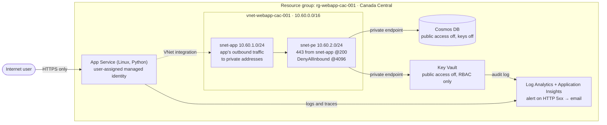

# Azure Secure Web App

[](https://github.com/mohamedhirey/azure-secure-web-app/actions/workflows/ci.yml)
[](#)
[](#)
[](#)
[](#)

A web application on Azure App Service whose database and secret store **refuse data requests from the public network and accept no keys**. The app reaches Cosmos DB and Key Vault through private endpoints, signs in with a managed identity, and is watched by Log Analytics, Application Insights and an alert that has been made to fire on purpose. Built with Terraform, deployed in one session, verified against live Azure, and torn down in that session. [Limits](#limits) says what it does not do.

> **Evidence status:** Deployed and verified on 19 November 2026 (UTC), then removed. No Azure resource remains.
> It ran in West US 3, because the subscription was not allowed a Cosmos DB account in Canada Central. The captured proof is in [`docs/evidence/`](docs/evidence/README.md). The full deployment ran on the first commit, `6631a6f`. Its first teardown failed. The fix, which release [`v1.0.0`](https://github.com/mohamedhirey/azure-secure-web-app/releases/tag/v1.0.0) contains, was then applied and destroyed on its own. The whole app has not been deployed together with that fix.
> Nothing has been deployed since that release, and no resource has changed. Later changes are tests, CI and documentation, checked on every pull request. Only the unit tests use mocked providers. The deployment and its evidence are from live Azure.

**Author:** Mohamed Hirey — Azure Cloud Engineer · [linkedin.com/in/mohamedhirey](https://linkedin.com/in/mohamedhirey)

Companion project: [**Azure Hub-and-Spoke Landing Zone**](https://github.com/mohamedhirey/azure-hub-spoke-landing-zone) covers network topology and a secretless OIDC deployment pipeline. This one covers what runs on top: platform services, identity, private connectivity and monitoring.

---

## The problem this solves

The usual first version of a cloud web app has a database connection string pasted into its settings and a database reachable from the whole internet. Each of those is one leak away from a breach:

- **A key in configuration** is copied into pipelines, laptops and chat messages, and rotating it means an outage window.
- **A public database endpoint** is protected only by that key.
- **No monitoring** means the first person to notice a failure is a customer.

**The delivery:** an app that stores no key or password for its data, a data tier that refuses data requests from the public network, the subscription owner's included, and an alert that has been seen firing.

---

## Architecture



---

## Evidence

Deployed to a real subscription on 19 November 2026 (UTC), verified, and removed. Full index: [`docs/evidence/`](docs/evidence/README.md).

The strongest single proof is the vault's own audit log. The app's identity is refused when its request arrives from a public address, and allowed when it arrives over the private endpoint. The subscription owner is then refused twice: first by RBAC and, once granted the role, by the network. Four of its rows:

```text
Time (UTC)  Operation  Result     Caller address           Caller               Reason
02:48:56    SecretGet  Forbidden  <app-service-public-ip>  app identity         Public network access is disabled
02:49:28    SecretGet  OK         10.60.1.254              app identity
02:59:08    SecretGet  Forbidden  <public address>         subscription owner   Caller is not authorized
03:00:24    SecretGet  Forbidden  <public address>         owner, role granted  Public network access is disabled
```

| Claim | Proof |
|---|---|
| The app reaches its data with no stored key or connection string | Counter rises and `secret_from_key_vault` is `true`: [`03-app-works.txt`](docs/evidence/03-app-works.txt) |
| The app's identity holds two role assignments and nothing else | Read secrets in one vault. Read, write, query and delete items in one database: [`04-identity-and-least-privilege.txt`](docs/evidence/04-identity-and-least-privilege.txt) |
| Cosmos DB and Key Vault have no public data path | Key Vault answers `ForbiddenByConnection`. Cosmos DB, given a valid Entra ID token from the internet, answers `403`, blocked by the account firewall: [`05-data-tier-private.txt`](docs/evidence/05-data-tier-private.txt) |
| Requests to the app and accesses to the vault are logged | [`06-logs-and-traces.txt`](docs/evidence/06-logs-and-traces.txt) |
| The alert has been seen firing | 12 errors at 02:58, fired at 03:01, resolved at 03:08: [`07-alert-fired.txt`](docs/evidence/07-alert-fired.txt) |
| The tests can fail | Open Cosmos DB to the internet, watch 1 of 4 fail, restore: [`01-unit-tests.txt`](docs/evidence/01-unit-tests.txt) |
| Nothing was left behind | The first `terraform destroy` failed. That, the fix, and the run proving the fix are all recorded. The subscription ended with 0 resources and nothing soft-deleted: [`08-teardown.txt`](docs/evidence/08-teardown.txt) |

---

## Engineering decisions made

| Decision | Reasoning |
|---|---|
| **Managed identity, not a database key** | The app proves who it is to Entra ID and receives a short-lived token. The app holds no database key to leak, store or rotate. |
| **Cosmos DB account keys disabled** | `local_authentication_enabled = false` removes key authentication entirely. Identity-based access is not just preferred, it is the only option. |
| **Public network access disabled on both data services** | The only route to the data for the app, or for any user, is a private endpoint inside the virtual network. Verified from both sides: the vault's audit log shows the app's own identity refused from a public address and allowed over the private endpoint, and the subscription owner, even after being granted the secrets role, is refused by the network. |
| **User-assigned identity, created before the app** | Every role assignment is created before the app, so the Key Vault reference can resolve at first start instead of failing until a restart. |
| **Least-privilege roles** | `Key Vault Secrets User` can read secret values and their metadata. It cannot write or delete a secret, or change who has access. The Cosmos DB role is the built-in data contributor, scoped to one database, not the account. It also allows querying and deleting items. |
| **Secret written through the control plane** | Terraform creates the secret through Azure Resource Manager, never connecting to the vault itself. So the vault needs no firewall exception for the machine running Terraform. It is written by an action, not as a managed resource: Resource Manager has no DELETE for a secret, and the first real teardown failed on exactly that. |
| **Key Vault reference in app settings** | The platform fetches the secret and hands the app the value. The secret never appears in the app's configuration, the repository or a pipeline. |
| **Default-deny on the private endpoint subnet** | Only HTTPS from the app's subnet is allowed; the catch-all deny sits at 4096 so any broken allow fails closed. |
| **No publishing passwords** | FTP and basic-auth deployment are disabled. Code is deployed with an Entra ID sign-in. |
| **An alert that has been seen firing** | The app has a `/fail` endpoint for exactly this. An alert that has never fired is an alert that has not been tested. |
| **Local state** | One person, one session, created and destroyed the same day. The companion project demonstrates keyless remote state. |

---

## Limits

What this build does not do, and what a production version would add.

| Limit | A production version would |
|---|---|
| **"Private" means the data plane.** Requests for data from outside the virtual network are refused. Management operations go through Azure Resource Manager and are not: an Owner can still write a secret, or switch public access back on, from anywhere. Nothing here prevents that or alerts on it. Key Vault's bypass for trusted Microsoft services is also left at its default. | Deny those changes with Azure Policy, add resource locks, and alert on the activity log. |
| **The app's own endpoint is public and has no sign-in.** Anyone on the internet can reach it over HTTPS, nothing filters the requests, and every request to `/` reads and writes Cosmos DB. The `/fail` route, which exists to test the alert, is open too. So is the deployment endpoint, although it accepts Entra ID sign-ins only. | Put Azure Front Door or Application Gateway with a web application firewall in front, restrict the app to traffic from there, close the deployment endpoint to public traffic, add authentication, and remove `/fail`. |
| **Outbound traffic is not controlled.** Only traffic to private addresses goes through the virtual network. Everything else leaves the app directly. | Route all outbound traffic through the virtual network and a firewall. |
| **Telemetry is sent with a connection string**, held in an app setting. It is the one credential-like value in the app's settings. Microsoft treats it as an identifier, not a secret, but anyone who has it can send telemetry to this resource. | Switch off local authentication on Application Insights, give the app's identity the `Monitoring Metrics Publisher` role, and send telemetry as that identity. |
| **Monitoring is reached over public endpoints.** Private endpoints cover Cosmos DB and Key Vault only. | Add an Azure Monitor Private Link Scope with a private endpoint, and switch off public ingestion and query. |
| **Cosmos DB's own request log is not collected.** The app's calls appear in Application Insights. A request from any other caller would leave no record. | Add a diagnostic setting for the account. |
| **Key Vault purge protection is off**, and soft-delete retention is at its 7-day minimum. With purge protection on, a deleted vault stays recoverable until retention ends, and the teardown check in this repository could not pass. | Turn purge protection on, with the default 90-day retention. |
| **Terraform state is local and holds secrets in plain text**: the demo secret, and the keys Azure issues for Cosmos DB, Log Analytics and Application Insights. | Use remote state with no account keys, as the companion project does, and set the secret outside Terraform. |
| **The secret is written once and never rotated.** | Rotate it, and give it an expiry date. |
| **One instance, one region.** A single B1 instance, and a serverless Cosmos DB account, which cannot add a region. No zone redundancy, and backups are the platform default. The health check does not test the database or the vault. | Size and replicate for the availability the workload needs. |
| **Terraform and the code are both deployed from a workstation**, by an account that holds Owner on the subscription. | Deploy from a pipeline with OIDC and narrower roles, as the companion project deploys its network. |
| **Most resource names carry the `cac` region code whatever region is chosen.** The recorded deployment ran in West US 3 under those names. | Derive the code from the location. |
| **One alert rule, one email address.** | Add alerts on latency and availability, and an on-call route. |

---

## Repository layout

```
azure-secure-web-app/
├── README.md                    This file — architecture and rationale
├── GUIDE.md                     Deployment guide: 18 steps, prerequisites to teardown
│
├── infra/                       Terraform — one root module, one file per concern
│   ├── network.tf               Resource group, VNet, subnets, NSG, private endpoints, private DNS
│   ├── data.tf                  Cosmos DB, Key Vault, the demo secret
│   ├── identity.tf              Managed identity and its two role assignments
│   ├── app.tf                   App Service plan and web app
│   ├── monitoring.tf            Log Analytics, Application Insights, diagnostics, alert
│   ├── variables.tf  outputs.tf  versions.tf
│   ├── terraform.tfvars.example
│   └── tests/posture.tftest.hcl 4 unit tests, plan-only, mocked providers
│
├── app/                         The web app
│   ├── app.py                   Flask: visit counter in Cosmos DB, /health, /fail
│   └── requirements.txt
│
├── .github/workflows/ci.yml     fmt, validate, unit tests, tflint — no cloud credentials
└── docs/evidence/               Captured output from the deployment, redacted
```

---

## What gets deployed

32 Terraform resources:

| Count | Resource |
|---|---|
| 1 | Resource group |
| 1 | Virtual network with 2 subnets |
| 1 | Network security group, 2 rules, 1 subnet association |
| 2 | Private endpoints, each with a private DNS zone and VNet link |
| 1 | Cosmos DB account (serverless) with 1 database and 1 container |
| 1 | Key Vault with 1 secret |
| 1 | Managed identity with 2 role assignments |
| 1 | App Service plan (B1) and 1 web app |
| 1 | Log Analytics workspace and 1 Application Insights instance |
| 2 | Diagnostic settings |
| 1 | Action group and 1 metric alert |
| 2 | Random values (name suffix, demo secret) |

## What this costs

Unlike the landing zone project, this one is **not free while it exists**. Approximate figures; check the Azure pricing page for your region:

| Resource | While running |
|---|---|
| App Service plan B1 (Linux) | about $0.02 per hour |
| 2 private endpoints | about $0.01 per hour each |
| 2 private DNS zones | about $0.50 per month each |
| Cosmos DB serverless, Key Vault, Log Analytics | cents for this volume |

A three-hour session costs well under a dollar. Left running, it is roughly $30 a month — which is why teardown is part of the build, not an afterthought.
